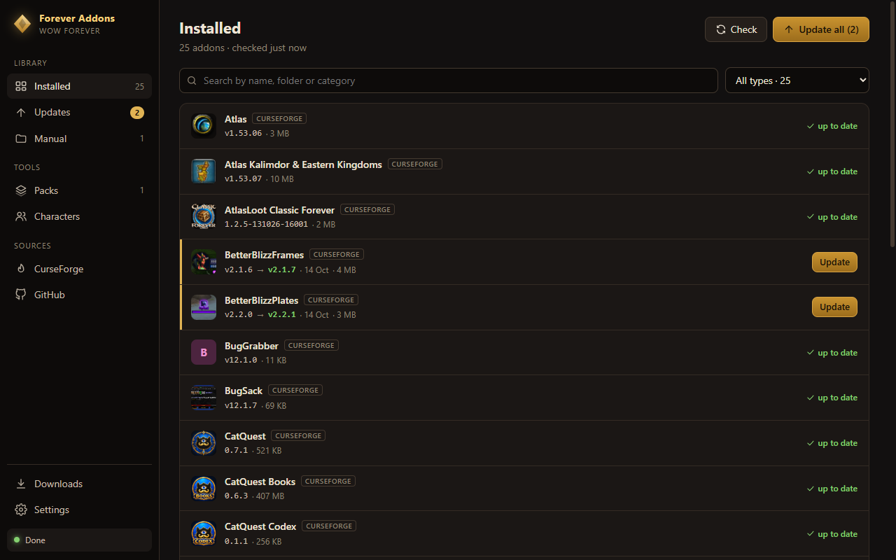
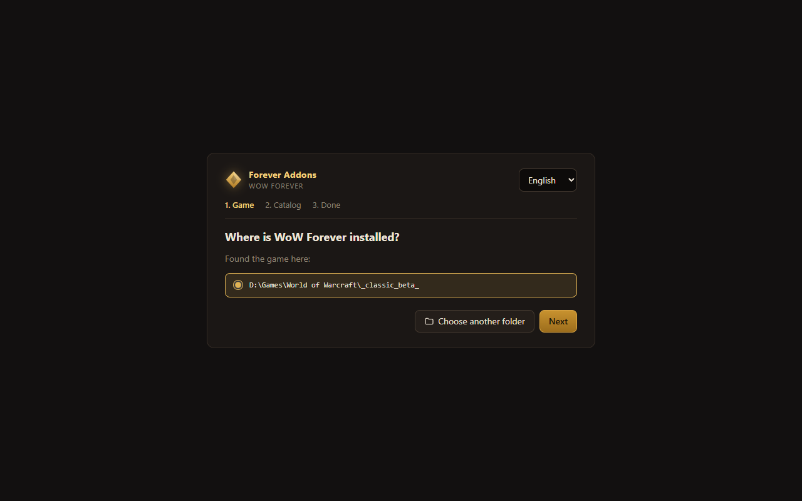
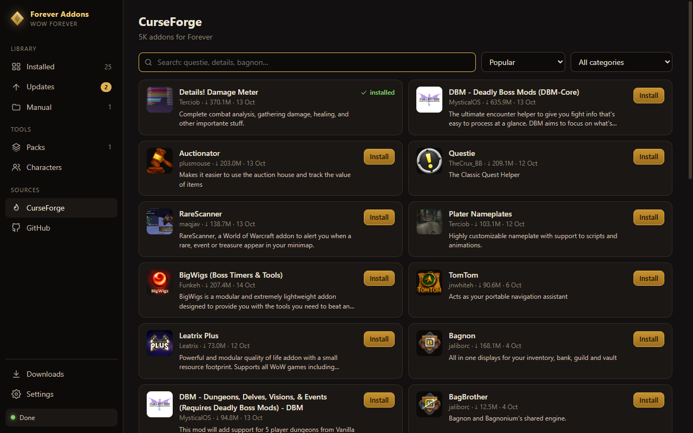

<p align="center">
  <a href="README.md">Русский</a> · <b>English</b>
</p>

<p align="center">
  
</p>

<h1 align="center">WoW Forever Addons Manager</h1>

<p align="center">
  <b>Set up your interface once — and every character and every friend gets it.</b><br />
  The app installs and updates addons for WoW Forever, copies your settings<br />
  to another character, and packs them into one file a friend opens in a couple of clicks.
</p>

<p align="center">
  <a href="https://github.com/Prophet73/wow-forever-addons-manager/releases/latest/download/ForeverAddons-portable.exe"><b>⬇ Download for Windows</b></a>
  <br />
  <sub>Free · a single file, nothing to install · beta</sub>
  <br />
  <sub><a href="https://github.com/Prophet73/wow-forever-addons-manager/releases">What's new</a></sub>
</p>



> **Beta.** I use it every day myself. The app makes a backup before every change, so it's hard to break your game.
> Found a bug or have an idea? [Tell me](https://github.com/Prophet73/wow-forever-addons-manager/issues/new).

## From the author

My little bro, a total newbie, is joining me when WoW Forever launches, and I wanted him to have a decent interface from day one. That's where the pain showed up: installing addons is only half the job. Then you tweak every single one by hand — moving frames, sizes, fonts, timers, key bindings. That takes a whole evening, and on your second character you start all over again.

So I built this. I set up my interface once, and now I hand it over as a single file: my friend presses “Apply” and gets the same addons with the same settings. Updating addons is a couple of clicks right in the manager, and you can move your interface to any of your characters.

Enjoy. If something breaks, let me know and I'll fix it.

— prophet73

## What it does

**The main thing — you never set up your interface twice:**

- **Share it with a friend.** The app packs your addons together with their settings into one file. Your friend opens it, presses “Apply” — and has everything you have: the same addons, frames in the same places, the same key bindings and macros.
- **Move it to another character.** Set up one character, then copy frames, key bindings, macros and chat to any other in a couple of clicks.
- **Undo anything.** Before it changes any settings, the app saves a copy. Don't like the result? One button puts everything back.

**It also looks after your addons:**

- **Updates every addon with one button** and checks for new versions every time it starts.
- **Installs only what works in Forever.** If an addon has no stable version, it takes the beta.
- **Rolls updates back.** A new version broke an addon? The previous one is a click away.
- **Finds new addons** in the CurseForge catalog and installs them from GitHub by link.
- **Picks up addons you installed yourself** and keeps them updated from then on.
- **Stays out of the game's way.** While WoW is open, it touches nothing. If an install is interrupted, your addons folder stays as it was.
- **Updates itself.** When a new version is out, the app offers to update.
- **Speaks English and Russian.** Switch in Settings at any time.

## Ready-made pack: my priest

To show how it works, here's my own priest interface for PvE and PvP. Apply it, and you get my 25 addons already set up.

Inside: X-Perl frames (player, target and focus in one row under your character), VuhDo raid frames, NeedToKnow timers over the frames, BetterBlizzPlates nameplates with full health numbers, Details, Quartz, Prat and more.

How to apply it:
1. Close the game.
2. In the app, open **Packs**. At the top, under “Ready-made packs”, press **Apply** on the priest.
3. Choose your character and confirm. The app downloads the pack, installs the addons and lays out the settings, making a backup first.

Or as a file: [download the priest pack](https://github.com/Prophet73/wow-forever-addons-manager/raw/release/packs/Priest-prophet73.fapack) (60 KB), then **Packs** → **Open file**.

Keep in mind:
- It's set up for a **2560×1440** monitor at UI scale **0.64**. At another resolution frames may sit differently — move them to taste.
- The NeedToKnow timers are for a priest on the **Russian game client**: aura names have to match.
- Don't like it? **Characters** → **Backups** → **Restore**.

## Get started in two minutes

There's nothing to install: the whole app is one file.

1. **Download** [ForeverAddons-portable.exe](https://github.com/Prophet73/wow-forever-addons-manager/releases/latest/download/ForeverAddons-portable.exe). The link always points to the latest version.
2. **Put it in its own folder**, e.g. `D:\Games\Forever Addons`. A `Forever Addons Data` folder with your settings appears next to the exe, so your desktop or Downloads isn't the best place.
3. **Run it** with a double-click.
4. **Windows may complain** with a blue “Windows protected your PC” window. That's because I haven't bought a code-signing certificate: it costs hundreds of dollars a year. Click **More info** → **Run anyway**; it won't ask again.
5. **Wait a couple of seconds**: on first start the app unpacks itself. Then the setup wizard opens.
6. **Optional: a CurseForge key.** Everything works without it: ready-made packs, installing and updating addons. The key is only for searching the catalog for new addons. It's free and takes a couple of minutes: [how to get a key](#curseforge-key).

### Setup wizard



**1. Game.** The app looks for WoW Forever on all your drives by itself.
If it found it, check the path and press **Next**. If not, press **Choose another folder** and pick `World of Warcraft`. Any folder inside it works too — the app finds the right one.

**2. Catalog.** Paste your CurseForge key and press **Check**. No key yet? [Here's how to get one](#curseforge-key). You can skip this step and add the key later in **Settings**, but without it there's no catalog or search.

**3. Done.** If you already have addons in the game, the app tells you how many of them it can keep updated. Press **See addons** to take them over.

## How to use it

Everything is in the menu on the left.

### Take over addons you already have

Already have addons you installed by hand? No need to delete anything.

1. Open **Manual**.
2. Under “Can be taken over”, press **Take over**.
3. The app replaces your copy with the latest Forever build and keeps it updated from then on.

The “No source” block lists folders the app knows nothing about. Find that addon in the catalog and install it from there.

### Update addons

1. Open **Updates**. The app checks addons every time it starts, or press **Check**.
2. Press **Update all**, or **Update** on a single addon.
3. Installs run in the background one at a time; follow them in **Downloads**.

If the game is open, installing waits and resumes on its own once you close WoW.

### Install a new addon

- **From the catalog:** **CurseForge** → search or category → **Install**. Needs a [key](#curseforge-key).
- **From GitHub:** **GitHub** → paste a repository link → **Add and install**.



### Roll back, remove, pick a channel

Click an addon in **Installed** to open its card:
- **Roll back** returns the previous version. How many versions to keep is set in **Settings**.
- There you can also **remove** the addon or choose what to install for it: stable versions only, betas too, or everything including alphas.

### Share a pack with a friend

1. **Packs** → **Pack from installed** → give it a name → save.
2. Press **Share** and choose:
   - **Addons only: code.** A short line of text, handy for Discord.
   - **Addons and my interface: file.** A `.fapack` file: the addons plus frame positions, key bindings, macros, chat and addon settings of the character you pick.
3. Your friend opens **Packs** → **Paste code** or **Open file** and presses **Apply**.

Before writing someone else's settings, the app saves a backup.

### Move your interface to another character

1. Close the game.
2. **Characters** → **Copy**.
3. Pick the character to copy **from**, then the ones to copy **to**.
4. Tick what to move: layout, chat, key bindings, macros, enabled addons, settings of specific addons.
5. Press **Copy**.

The app makes a backup before copying. **Characters** → **Backups** puts everything back.

## CurseForge key

The key is only for searching the CurseForge catalog: ready-made packs, installing and updating addons work without it. It's free, everyone has their own, and getting one takes a couple of minutes.

1. Go to [console.curseforge.com](https://console.curseforge.com/) and sign in or sign up.
2. If the site asks for an organization name, enter anything, e.g. your nickname.
3. On the left, open **API Keys** and copy the key. It's long and starts with `$2a$10$`.
4. In the app, open **Settings**, paste the key into “API key” and press **Save**. “key works” appears next to the heading.

## FAQ

**It says “Game is running” and installs nothing.**
That's on purpose: the game holds the addon files and overwrites settings when it exits. Close WoW and the queue continues by itself.

**Download fails with “HTTP 403”.**
Most likely the addon's author just published the version and CurseForge isn't serving it yet. Try again in a few minutes.

**It says “Key rejected”.**
Check that you copied the whole key. If it's right, press **Check again** in the catalog: CurseForge sometimes answers with an error.

**My antivirus complains.**
Some antivirus programs distrust new apps without a paid signature. There are no viruses in it: all the code is open right here, anyone can see what the app does. If your antivirus removed or blocked the file, add it to the exceptions and download it again. Only download it from the link on this page, not from other sites.

**How do I update the app itself?**
You don't need to do anything. When a new version is out, a banner appears at the top: press **Update and restart**, and the app downloads the update, replaces itself and opens again. Your settings stay.

**Where is my data?**
The app's settings are in the `Forever Addons Data` folder next to the exe. Downloads and backups of addons and characters are in the game folder, in `.forever-addons`.

**How do I move the app?**
Move the exe together with the `Forever Addons Data` folder.

**How do I uninstall it?**
Delete the exe and the `Forever Addons Data` folder, and `.forever-addons` in the game folder if you like. Installed addons stay in the game.

## Help the project

- **Star ⭐** the repository: it helps other players find it.
- **Tell** your guild or your Forever Discord about it.
- **Found a bug or missing something?** [Open an issue](https://github.com/Prophet73/wow-forever-addons-manager/issues/new).

## For developers

Requires Node.js 22+.

```
npm install
npm start            # run from source
npm run typecheck    # type check
npm run dist         # build the portable exe into release/
```

```
src/main/            Electron process: installing, storage, character settings, self-update
  providers/         addon sources (CurseForge, GitHub) behind one interface
src/preload/         bridge between the window and the process
src/renderer/        React interface
  views/             sidebar screens
src/shared/          types and helpers for both sides, translations (i18n.ts, i18n.en.ts)
```

Translations: the Russian text in the code is its own key, `t("Обновления")`; English lives in `src/shared/i18n.en.ts`.

Want to improve something yourself? Fork the repo, make your changes and send a pull request: I'll review it and add it to the app. Before sending, check that the code builds without errors: `npm run typecheck`.

## License

[MIT](LICENSE): use, change and share it freely.

Forever Addons is a fan project. It is not affiliated with Blizzard Entertainment, CurseForge or the WoW Forever team.
