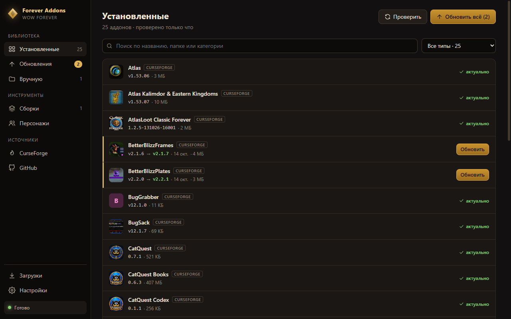
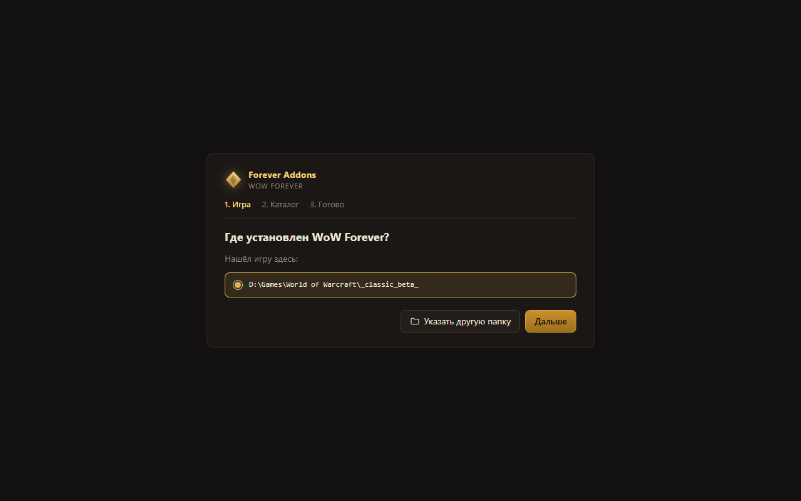
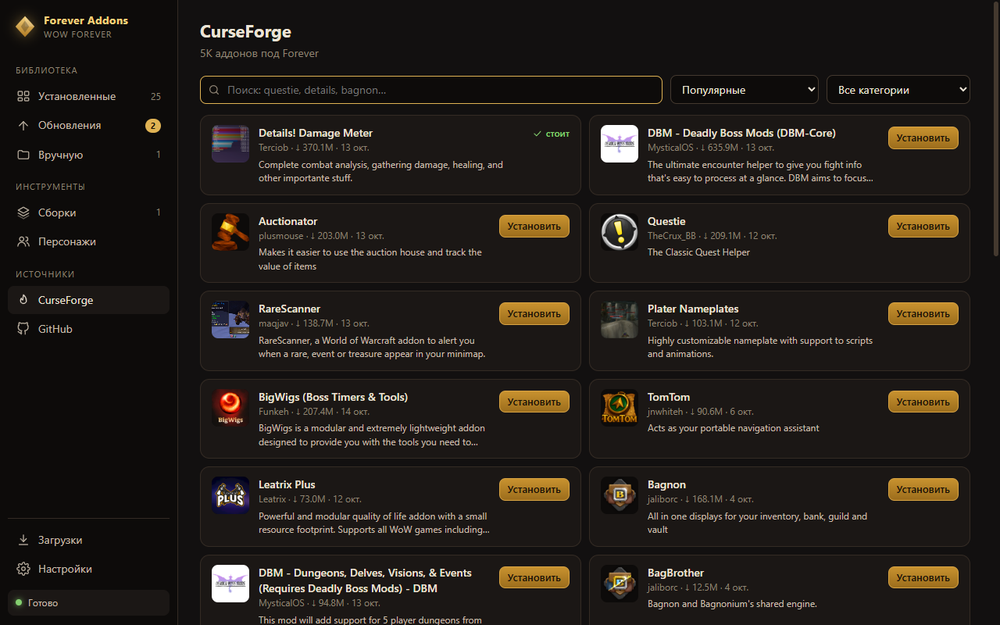

<p align="center">
  <b>Русский</b> · <a href="README.en.md">English</a>
</p>

<p align="center">
  
</p>

<h1 align="center">WoW Forever Addons Manager</h1>

<p align="center">
  <b>Настроил интерфейс один раз — и он есть у всех твоих персонажей и у друзей.</b><br />
  Программа ставит и обновляет аддоны для WoW Forever, переносит твои настройки<br />
  на другого персонажа и упаковывает их в один файл, который друг откроет в пару кликов.
</p>

<p align="center">
  <a href="https://github.com/Prophet73/wow-forever-addons-manager/releases/latest/download/ForeverAddons-portable.exe"><b>⬇ Скачать для Windows</b></a>
  <br />
  <sub>Бесплатно · один файл, ничего не нужно устанавливать · бета</sub>
  <br />
  <sub><a href="https://github.com/Prophet73/wow-forever-addons-manager/releases">Что нового</a></sub>
</p>



> **Бета.** Сам пользуюсь каждый день. Перед каждым изменением программа делает бэкап, так что сломать игру трудно.
> Нашёл баг или есть идея? [Напиши](https://github.com/Prophet73/wow-forever-addons-manager/issues/new).

## От автора

Короче, нубасик-братишка присоединится ко мне на релизе WoW Forever, и я захотел, чтобы у него сразу был нормальный интерфейс. Тут-то и вылезла боль: поставить аддоны — полбеды. Потом каждый надо настраивать лапками: двигать рамки, выставлять размеры, шрифты, таймеры, бинды. На это уходит целый вечер, а на втором персонаже всё по новой.

Так и появилась эта штука. Я один раз собрал и настроил интерфейс, и теперь отдаю его одним файлом: друг жмёт «Применить» и получает те же аддоны с теми же настройками. Обновлять аддоны потом можно прямо в менеджере, в пару кликов, а свой интерфейс — перекинуть на любого персонажа.

Пользуйся на здоровье. Если что-то сломалось, пиши, починю.

— prophet73

## Что умеет

**Главное — твой интерфейс не надо настраивать заново:**

- **Поделиться с другом.** Программа собирает твои аддоны вместе с их настройками в один файл. Друг открывает его, жмёт «Применить» — и у него всё как у тебя: те же аддоны, рамки на тех же местах, те же бинды и макросы.
- **Перенести на другого персонажа.** Настроил одного — скопируй рамки, бинды, макросы и чат на любого другого в пару кликов.
- **Можно отменить.** Перед тем как что-то поменять в настройках, программа сохраняет копию. Не понравилось — вернёшь как было одной кнопкой.

**А ещё она следит за аддонами:**

- **Обновляет все аддоны одной кнопкой** и проверяет, не вышло ли новое, при каждом запуске.
- **Ставит только то, что работает в Forever.** Если у аддона нет стабильной версии, берёт бету.
- **Откатывает обновление.** Новая версия аддона сломалась? Прошлая возвращается в один клик.
- **Ищет новые аддоны** в каталоге CurseForge и ставит их с GitHub по ссылке.
- **Подхватывает аддоны, которые ты поставил сам,** и дальше обновляет их.
- **Не мешает игре.** Пока WoW открыт, ничего не трогает. Если установка оборвалась, папка с аддонами остаётся как была.
- **Обновляется сама.** Когда выходит новая версия программы, она предлагает обновиться.
- **Говорит по-русски и по-английски.** Язык переключается в Настройках.

## Начать за две минуты

Ничего не нужно устанавливать: вся программа — один файл.

1. **Скачай** [ForeverAddons-portable.exe](https://github.com/Prophet73/wow-forever-addons-manager/releases/latest/download/ForeverAddons-portable.exe). Ссылка всегда ведёт на свежую версию.
2. **Положи его в отдельную папку**, например `D:\Games\Forever Addons`. Рядом с exe появится папка `Forever Addons Data` с настройками, так что рабочий стол и «Загрузки» — не лучшее место.
3. **Запусти** двойным щелчком.
4. **Windows может ругнуться** синим окном «Система Windows защитила ваш компьютер». Это потому, что я не покупал сертификат подписи: он стоит сотни долларов в год. Жми **Подробнее** → **Выполнить в любом случае**, больше она не спросит.
5. **Подожди пару секунд**: при первом запуске программа распаковывается. Дальше откроется мастер настройки.
6. **Зарегистрируйся на CurseForge и возьми ключ.** Это бесплатно и занимает пару минут, а без ключа не будет каталога и поиска аддонов. [Как получить ключ](#ключ-curseforge).

### Мастер первого запуска



**1. Игра.** Программа сама ищет WoW Forever на всех дисках.
Если нашла, проверь путь и нажми **Дальше**. Если нет, нажми **Указать другую папку** и выбери `World of Warcraft`. Подойдёт и любая папка внутри неё, нужную программа найдёт сама.

**2. Каталог.** Вставь ключ CurseForge и нажми **Проверить**. Ключа ещё нет? [Вот как его получить](#ключ-curseforge). Шаг можно пропустить и добавить ключ потом в **Настройках**, но без него не будет каталога и поиска.

**3. Готово.** Если в игре уже стоят аддоны, программа скажет, сколько из них может обновлять сама. Нажми **Посмотреть аддоны**, чтобы забрать их.

## Как пользоваться

Всё открывается из меню слева.

### Забрать аддоны, которые уже стоят

У тебя уже есть аддоны, поставленные вручную? Не нужно ничего удалять.

1. Открой **Вручную**.
2. В блоке «Можно взять под управление» нажми **Управлять**.
3. Программа поставит на место старой свежую версию под Forever и дальше будет обновлять её сама.

В блоке «Без источника» лежат папки, о которых программа ничего не знает. Найди такой аддон в каталоге и поставь оттуда.

### Обновить аддоны

1. Открой **Обновления**. Программа проверяет аддоны при каждом запуске, а вручную — кнопкой **Проверить**.
2. Нажми **Обновить всё** или **Обновить** у одного аддона.
3. Установки идут в фоне по очереди, следить за ними можно в **Загрузках**.

Если игра открыта, установка подождёт и сама продолжится, когда ты закроешь WoW.

### Поставить новый аддон

- **Из каталога:** **CurseForge** → поиск или категория → **Установить**. Нужен [ключ](#ключ-curseforge).
- **С GitHub:** **GitHub** → вставь ссылку на репозиторий → **Добавить и установить**.



### Откатить, удалить, выбрать канал

Нажми на аддон в **Установленных**, и откроется его карточка:
- **Откатить** вернёт прошлую версию. Сколько версий хранить для отката, задаётся в **Настройках**.
- Там же аддон можно **удалить** или выбрать, что ему ставить: только стабильные версии, ещё и беты или всё подряд, включая альфы.

### Поделиться сборкой с другом

1. **Сборки** → **Сборка из установленных** → придумай имя → сохрани.
2. Нажми **Поделиться** и выбери вариант:
   - **Только аддоны: код.** Короткая строка, её удобно скинуть в Discord.
   - **Аддоны и мой интерфейс: файл.** Файл `.fapack`: аддоны плюс расположение рамок, бинды, макросы, чат и настройки аддонов выбранного персонажа.
3. Друг открывает **Сборки** → **Вставить код** или **Открыть файл** и нажимает **Применить**.

Прежде чем записать чужие настройки, программа сохраняет бэкап.

### Перенести интерфейс на другого персонажа

1. Закрой игру.
2. **Персонажи** → **Копирование**.
3. Выбери персонажа, **с которого** копировать, и того, **на кого**.
4. Отметь, что переносить: расположение, чат, бинды, макросы, включённые аддоны, настройки отдельных аддонов.
5. Нажми **Скопировать**.

Перед копированием программа делает бэкап. Вернуть всё как было можно в **Персонажи** → **Бэкапы**.

## Ключ CurseForge

CurseForge раздаёт доступ к своему каталогу по личному ключу. Ключ бесплатный, у каждого свой, и получить его можно за пару минут.

1. Зайди на [console.curseforge.com](https://console.curseforge.com/) и войди или зарегистрируйся.
2. Если сайт спросит название организации, впиши любое, например свой ник.
3. Открой слева **API Keys** и скопируй ключ. Он длинный и начинается с `$2a$10$`.
4. В программе открой **Настройки**, вставь ключ в поле «API-ключ» и нажми **Сохранить**. Рядом с заголовком появится «ключ работает».

## Частые вопросы

**Пишет «Игра запущена» и ничего не ставит.**
Так задумано: игра держит файлы аддонов и при выходе перезаписывает настройки. Закрой WoW, и очередь продолжится сама.

**При скачивании выскакивает «HTTP 403».**
Скорее всего, автор аддона только что выложил версию, и CurseForge ещё не успел её раздать. Попробуй через несколько минут.

**Пишет «Ключ не принят».**
Проверь, что скопировал ключ целиком. Если всё верно, нажми в каталоге **Проверить ещё раз**: CurseForge иногда отвечает с ошибкой.

**Антивирус ругается.**
Некоторые антивирусы с подозрением относятся к новым программам без платной подписи. Вирусов там нет: весь код открыт и лежит здесь же, любой может посмотреть, что программа делает. Если антивирус удалил или заблокировал файл, добавь его в исключения и скачай заново. Качай только по ссылке с этой страницы, а не с чужих сайтов.

**Как обновить саму программу?**
Ничего делать не нужно. Когда выйдет новая версия, сверху появится плашка: нажми **Обновить и перезапустить**, и программа скачает обновление, заменит себя и откроется заново. Настройки сохранятся.

**Где хранятся данные?**
Настройки программы лежат в папке `Forever Addons Data` рядом с exe. Загрузки и бэкапы аддонов и персонажей хранятся в папке игры, в `.forever-addons`.

**Как перенести программу?**
Перенеси exe вместе с папкой `Forever Addons Data`.

**Как удалить?**
Удали exe и папку `Forever Addons Data`, а при желании и `.forever-addons` в папке игры. Поставленные аддоны останутся в игре.

## Помочь проекту

- **Поставь ⭐** репозиторию: так его проще найти другим игрокам.
- **Расскажи** о программе в гильдии или в Discord-сервере Forever.
- **Нашёл ошибку или придумал, чего не хватает?** [Открой issue](https://github.com/Prophet73/wow-forever-addons-manager/issues/new).

## Для разработчиков

Нужен Node.js 22+.

```
npm install
npm start            # запуск из исходников
npm run typecheck    # проверка типов
npm run dist         # собрать портативный exe в release/
```

```
src/main/            процесс Electron: установка, хранилище, настройки персонажей, самообновление
  providers/         источники аддонов (CurseForge, GitHub) с общим интерфейсом
src/preload/         мост между окном и процессом
src/renderer/        интерфейс на React
  views/             экраны бокового меню
src/shared/          типы и функции для обеих сторон, переводы (i18n.ts, i18n.en.ts)
```

Переводы: русский текст в коде сам служит ключом, `t("Обновления")`, английский лежит в `src/shared/i18n.en.ts`.

Хочешь что-то доработать сам? Сделай форк, внеси правки и пришли pull request: я посмотрю и добавлю в программу. Перед отправкой проверь, что код собирается без ошибок: `npm run typecheck`.

## Лицензия

[MIT](LICENSE) ([на русском](LICENSE.ru.md)): пользуйся, меняй и распространяй свободно.

Forever Addons — фанатский проект. Он не связан с Blizzard Entertainment, CurseForge или командой WoW Forever.
